# ReqPM - Python Requirements to RPM Package Manager

ReqPM is a comprehensive build system for creating RPM packages from Python projects with requirements files. It automates the process of building a Python project and all its dependencies as RPM packages for different RHEL versions.

## Features

- **Git Integration**: Pull Python projects directly from Git repositories
- **Dependency Resolution**: Automatically analyze requirements.txt and build dependency trees
- **Multi-Platform Builds**: Build for different RHEL versions simultaneously
- **Build Queue Management**: Intelligent build scheduling based on dependency order
- **Spec File Management**: Edit and version control spec files
- **Repository Publishing**: Automatic YUM/DNF repository creation and publishing
- **Web Interface**: Modern React UI for monitoring builds and managing projects
- **REST API**: Full API for automation and integration
- **JWT Authentication**: Secure API access with token-based auth

## Screenshots

### Dashboard
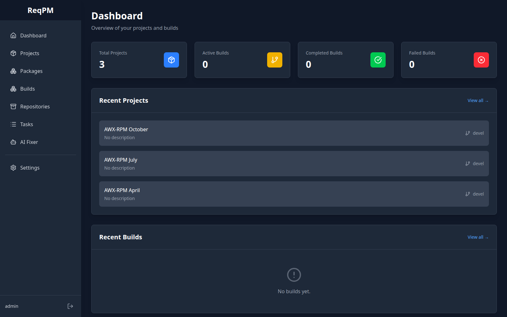

### Projects
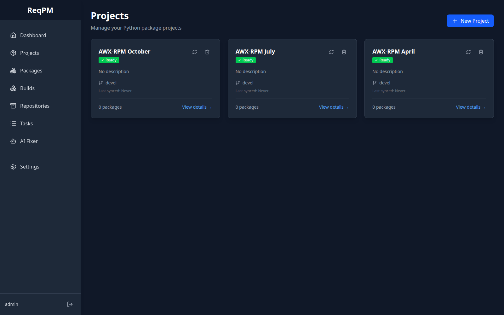

### Project Detail
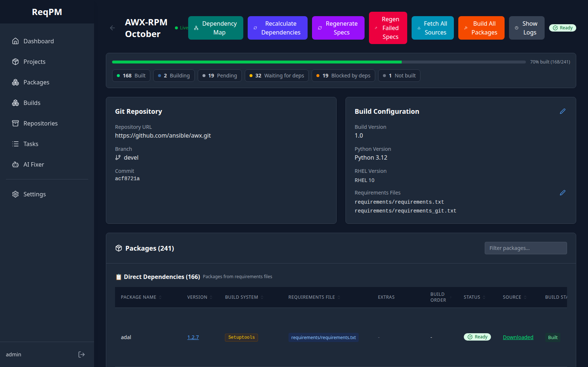

### Dependency Map
Interactive graph of direct and transitive dependencies, colored by build state.

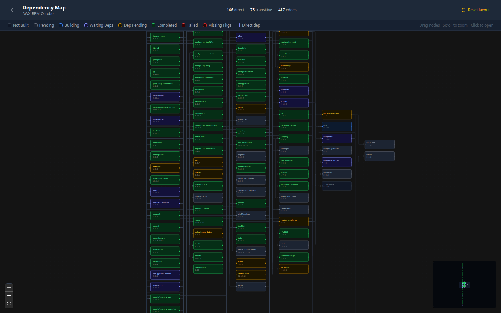

### Packages
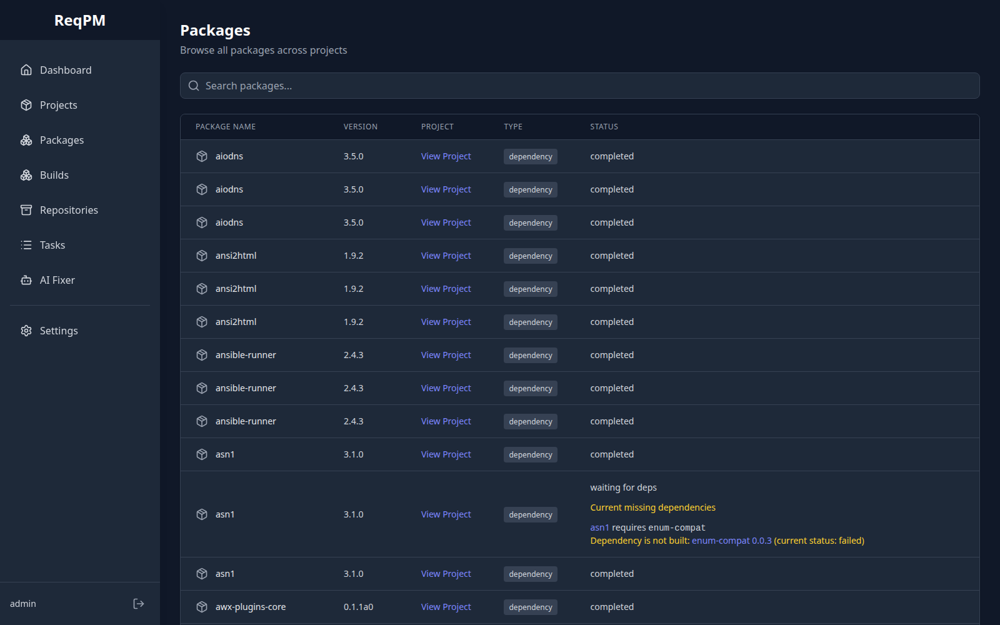

### Package Detail
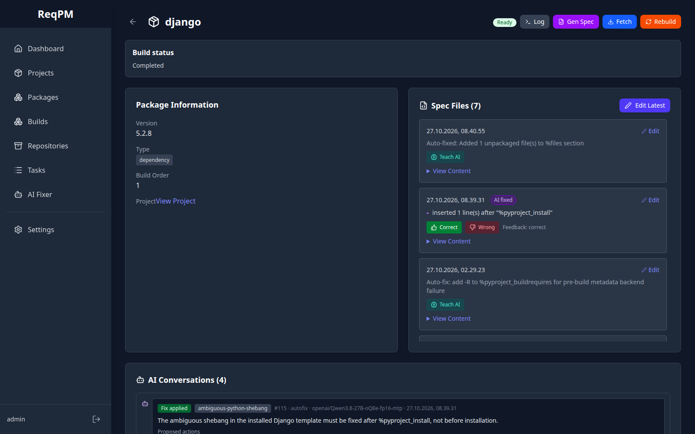

### Blocked Package
Packages waiting on dependencies show exactly which packages (and version constraints) are blocking them.

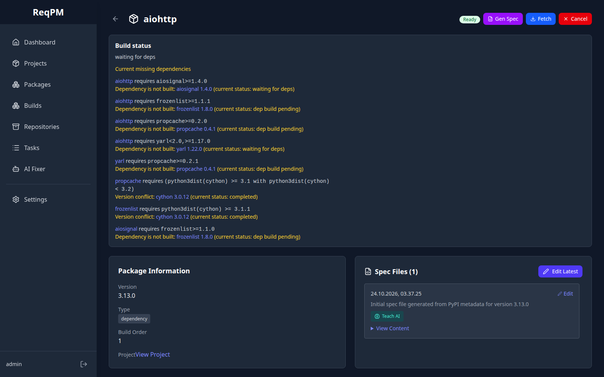

### Package Dependencies
Both the packages a package depends on and the packages that require it.

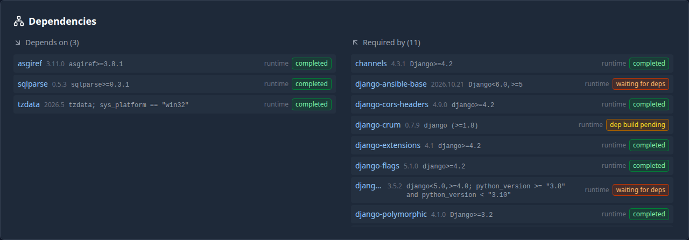

### AI Conversations
History of AI fix proposals, the actions applied to the spec file, and feedback.

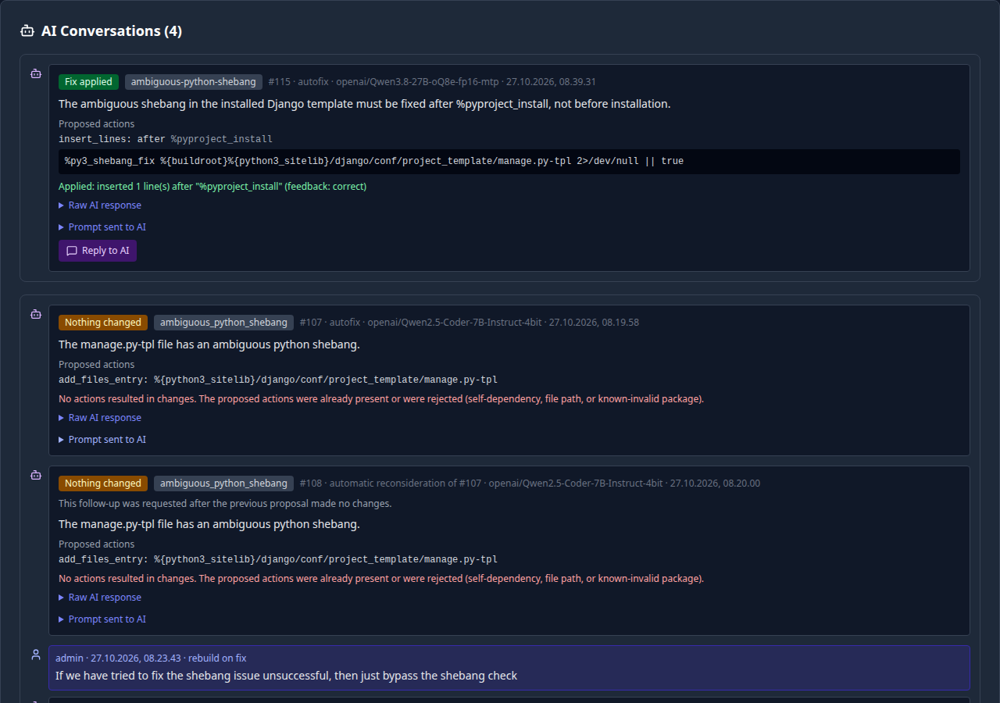

### AI Fixer
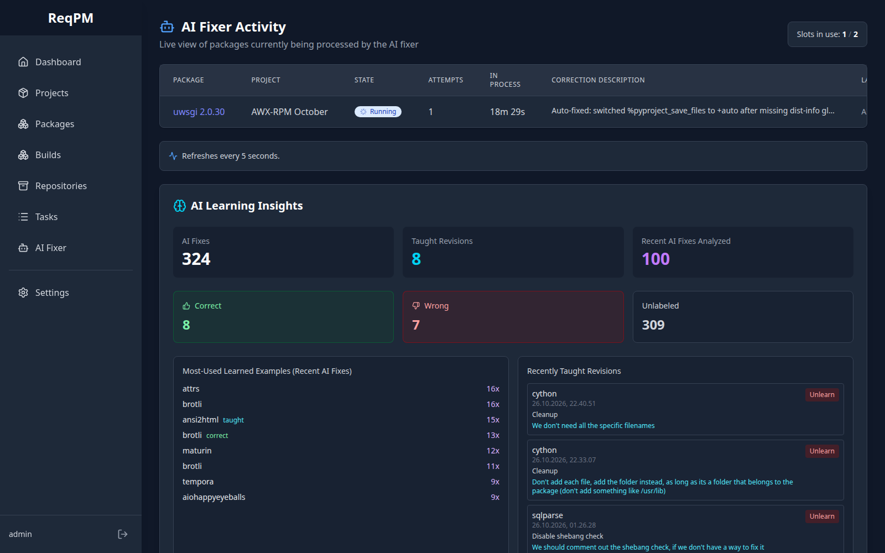

### Tasks
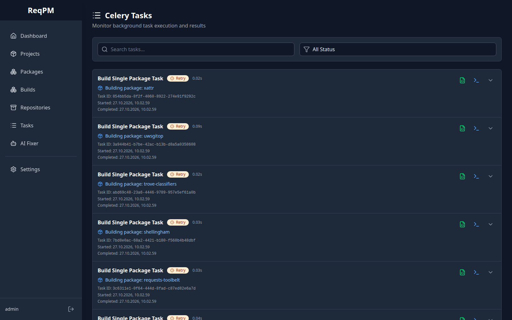

### Settings
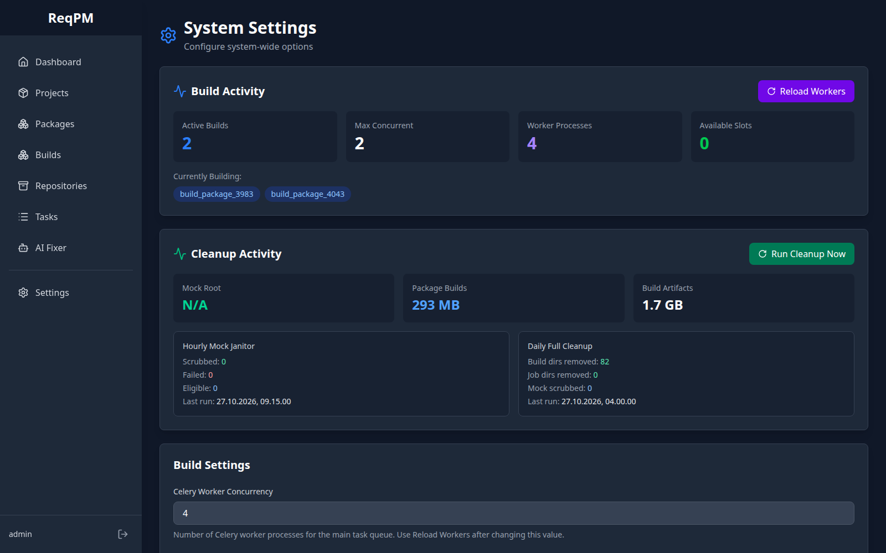

## Architecture

- **Backend**: Django 5.0 + Django REST Framework 3.14
- **Frontend**: React 18 + Vite + Tailwind CSS
- **Task Queue**: Celery with Redis
- **Database**: SQLite (dev) / MariaDB (production)
- **Build System**: Mock (pluggable architecture for other systems)
- **Repository Management**: createrepo_c

## Quick Start

### Prerequisites

- Python 3.9+
- Node.js 18+ (for frontend)
- Redis
- **Mock** (for building RPMs - see [Mock Setup Guide](docs/MOCK_SETUP.md))
- createrepo_c
- Git

### Installation

```bash
# Clone the repository
git clone <your-repo-url>
cd ReqPM

# Backend Setup
python3 -m venv venv
source venv/bin/activate
pip install -r requirements.txt

# Create .env file from example
cp .env.example .env

# Run migrations
python manage.py migrate

# Create superuser
python manage.py createsuperuser

# Frontend Setup
cd frontend
npm install
cp .env.example .env
cd ..
```

### Setting Up Mock (Required for Building RPMs)

Mock is required for building RPM packages.

**On RHEL/Fedora/CentOS:**
```bash
# Install Mock
sudo dnf install mock

# Add your user to the mock group
sudo usermod -a -G mock $USER

# Log out and log back in for group membership to take effect
```

**On Ubuntu/Debian:**
```bash
# Quick install from pre-built .deb package
./scripts/install-mock-deb.sh

# Or build the .deb package yourself
./scripts/build-mock-deb.sh
sudo dpkg -i build/mock-deb/output/mock_*.deb
sudo apt-get install -f
sudo usermod -a -G mock $USER

# Log out and log back in for group membership to take effect
```

**Important**: Builds will fail until Mock is properly installed and configured.

For detailed setup instructions, see:
- RHEL/Fedora: **[docs/MOCK_SETUP.md](docs/MOCK_SETUP.md)**
- Ubuntu/Debian: **[docs/MOCK_SETUP_UBUNTU.md](docs/MOCK_SETUP_UBUNTU.md)**

### Setting Up GPG Keys (Recommended)

ReqPM includes automatic GPG key management to prevent build failures due to outdated keys:

```bash
# Initialize GPG keys
./scripts/setup-gpg-keys.sh
```

This will:
- Download the latest GPG keys from [distribution-gpg-keys](https://github.com/rpm-software-management/distribution-gpg-keys)
- Install them to `/usr/share/distribution-gpg-keys/`
- Enable automatic updates (every 12 hours)

**Note**: GPG keys are automatically updated before builds if older than 7 days, so this step is optional but recommended to avoid delays during first builds.

See **[docs/GPG_KEY_MANAGEMENT.md](docs/GPG_KEY_MANAGEMENT.md)** for details.

### Running the Application

Use the provided control script to manage all services:

```bash
# Start all services (Redis, Django, Celery workers, Celery beat, Frontend)
./reqpm.sh start-all

# Check status
./reqpm.sh status

# View logs
./reqpm.sh logs all          # All services
./reqpm.sh logs frontend     # Frontend only

# Stop all services
./reqpm.sh stop-all

# Restart all services
./reqpm.sh restart-all
```

Or start services individually:

```bash
# Backend services
./reqpm.sh start-redis
./reqpm.sh start-django
./reqpm.sh start-celery          # Build worker (RPM builds only, `builds` queue)
./reqpm.sh start celery-tasks    # Tasks worker (fetching, spec generation, etc.)
./reqpm.sh start celery-ai       # Dedicated AI fixes and conversation replies
./reqpm.sh start-beat
```

Celery work is split across four workers so that long RPM builds never block
other work:

| Worker | Queue | Concurrency | Handles |
|--------|-------|-------------|---------|
| `celery` (builds) | `builds` | Settings → Celery Worker Concurrency | RPM builds |
| `celery-tasks` | `celery` | `CELERY_TASKS_CONCURRENCY` (default 2) | Source fetching, spec generation, monitoring, everything else |
| `celery-ai` | `ai` | Settings → AI Fix Worker Concurrency (default 2) | AI fixes and conversation replies |
| `celery-projects` | `projects` | 1 | Project clone/resolve/sync |

Fetching and spec generation use their own slot pool (`MAX_CONCURRENT_TASKS`,
default 2), separate from build slots.
AI model requests release their build slot and queue a rebuild after a successful
fix. Build and AI process counts are independent; use **Reload Workers** after
changing either concurrency setting. The separate AI maximum-concurrent-request
setting still limits calls to the model.

```bash

# Frontend
./reqpm.sh start-frontend
./reqpm.sh stop-frontend
```

The application will be available at:
- **Frontend**: http://localhost:5173
- **Backend API**: http://localhost:8000/api
- **API Documentation**: http://localhost:8000/api/docs/

# Create superuser
python manage.py createsuperuser

# Start development server
python manage.py runserver

# In other terminals, start the Celery workers
celery -A backend.reqpm worker -l info -Q builds --hostname=builds@%h
celery -A backend.reqpm worker -l info -Q celery --concurrency=2 --hostname=tasks@%h
celery -A backend.reqpm worker -l info -Q ai --concurrency=2 --hostname=ai@%h
celery -A backend.reqpm worker -l info -Q projects --concurrency=1 --hostname=projects@%h

# In another terminal, start Celery beat (for scheduled tasks)
celery -A reqpm beat -l info
```

## Project Structure

```
ReqPM/
├── backend/
│   ├── reqpm/              # Main Django project
│   ├── apps/
│   │   ├── users/          # User management
│   │   ├── projects/       # Project management
│   │   ├── packages/       # Package management
│   │   ├── builds/         # Build management
│   │   └── repositories/   # Repository management
│   ├── plugins/            # Plugin system
│   │   ├── builders/       # Build system plugins (Mock, etc.)
│   │   └── repositories/   # Repository plugins (createrepo_c, etc.)
│   └── core/               # Core utilities
├── frontend/               # React frontend (TBD)
├── docs/                   # Documentation
└── docker/                 # Docker configurations
```

## API Documentation

API documentation will be available at `/api/docs/` when running the server.

## Development

### Running Tests

```bash
python manage.py test
```

### Code Style

```bash
# Format code
black .

# Lint code
flake8 .
pylint backend/
```

## Production Deployment

See [docs/deployment.md](docs/deployment.md) for production deployment instructions.

## Contributing

Contributions are welcome! Please read our contributing guidelines (TBD).

## License

[To be determined]

## Inspired By

- [awx-rpm-v2](https://github.com/MrMEEE/awx-rpm-v2)
- [OpenSUSE Build Service](https://github.com/openSUSE/open-build-service)
- [Mock](https://github.com/rpm-software-management/mock)
